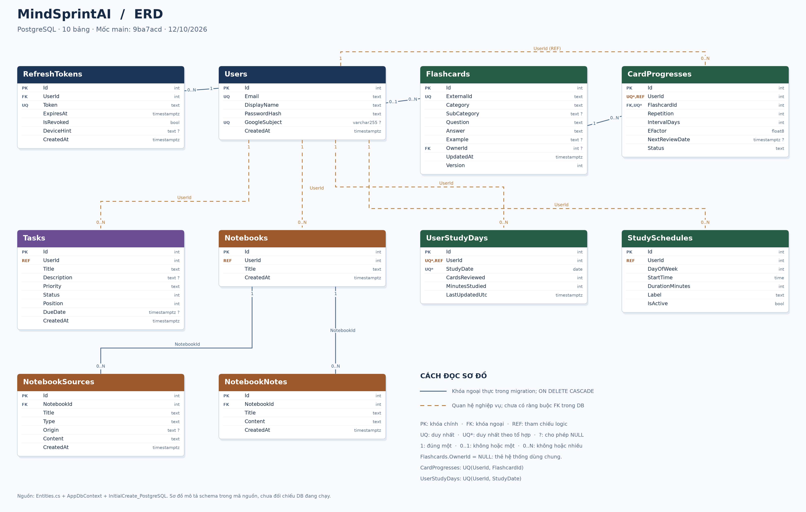
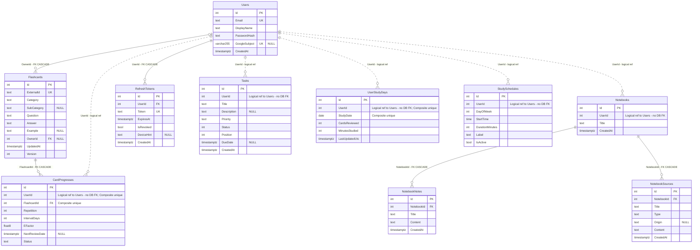

# ERD — MindSprintAI

**Ngày:** 12/10/2026. **Nguồn:** nhánh main tại commit 9ba7acd (PostgreSQL), cùng mốc tài liệu kiến trúc. ERD mô tả schema trong mã nguồn; chưa đối chiếu database đang chạy. Bản FastAPI/SQLite độc lập không thuộc sơ đồ này.

**Tải và chỉnh sửa:** [Ảnh PNG](erd.png) · [Vector SVG](erd.svg) · [Mermaid source](erd.mmd).

## Quy ước

- PK: khóa chính; FK: khóa ngoại đã khai báo trong migration; UK/UQ: unique index.
- REF: tham chiếu theo nghiệp vụ nhưng **chưa có ràng buộc FK** trong database.
- ?: nullable; UQ* là unique index theo tổ hợp cột, không có nghĩa từng cột duy nhất riêng.
- 1: đúng một; 0..1: tối đa một; 0..N: không hoặc nhiều.
- Trong sơ đồ này, nét liền đánh dấu quan hệ có FK thực; nét đứt đánh dấu tham chiếu nghiệp vụ chưa có FK. Đây là quy ước chú thích riêng của sơ đồ, không suy diễn tính identifying từ nét vẽ.

## 5 khóa ngoại thực

| Quan hệ | Số lượng | Khi xóa bản ghi cha |
| --- | --- | --- |
| Notebooks.Id → NotebookNotes.NotebookId | 1 → 0..N | CASCADE |
| Notebooks.Id → NotebookSources.NotebookId | 1 → 0..N | CASCADE |
| Users.Id → Flashcards.OwnerId | 0..1 → 0..N | CASCADE |
| Users.Id → RefreshTokens.UserId | 1 → 0..N | CASCADE |
| Flashcards.Id → CardProgresses.FlashcardId | 1 → 0..N | CASCADE |

Mọi bảng dùng Id kiểu integer làm PK, với IdentityByDefaultColumn theo migration. Flashcards.OwnerId cho phép NULL: thẻ hệ thống không thuộc tài khoản riêng. Quan hệ Users–Flashcards vì vậy là 0..1 ở phía user của mỗi thẻ.

## 5 tham chiếu nghiệp vụ chưa có FK

| Tham chiếu | Ý nghĩa |
| --- | --- |
| CardProgresses.UserId → Users.Id | Tiến trình ôn tập của người học |
| Tasks.UserId → Users.Id | Công việc của tài khoản |
| Notebooks.UserId → Users.Id | Chủ sở hữu sổ tay |
| UserStudyDays.UserId → Users.Id | Thống kê học theo ngày |
| StudySchedules.UserId → Users.Id | Lịch học của tài khoản |

Các quan hệ trên là 1 → 0..N theo nghiệp vụ; database hiện chưa bảo đảm bản ghi user tồn tại hoặc cascade khi xóa user. Không đánh dấu các cột này là FK trong phần thuộc tính Mermaid.

CardProgresses là bảng kết hợp Users–Flashcards về mặt nghiệp vụ: một người học nhiều thẻ và một thẻ có nhiều người học. Unique(UserId, FlashcardId) ngăn hai hàng progress của cùng người/thẻ.

## Unique indexes

| Bảng | Cột/tổ hợp | Ghi chú |
| --- | --- | --- |
| Users | Email | Unique index |
| Users | GoogleSubject | Chỉ áp dụng khi GoogleSubject khác NULL |
| UserStudyDays | UserId, StudyDate | Unique index |
| Flashcards | ExternalId | Unique index |
| RefreshTokens | Token | Unique index |
| CardProgresses | UserId, FlashcardId | Unique index |

Indexes thường (không unique): Flashcards.OwnerId, CardProgresses.FlashcardId, RefreshTokens.UserId, Notebooks.UserId, NotebookSources.NotebookId, NotebookNotes.NotebookId, Tasks(UserId, Status, Position), StudySchedules(UserId, DayOfWeek).

Tasks.Status lưu integer: 0=Todo, 1=Doing, 2=Done. StudySchedules.DayOfWeek: 0=Chủ nhật…6=Thứ bảy. Trong ERD, timestamptz là timestamp with time zone và time là time without time zone. Tên bảng là tên vật lý từ EF Core, ví dụ Tasks (entity KanbanTask).

## Sơ đồ Mermaid đầy đủ thuộc tính

## Nguồn kiểm chứng

- [Entities.cs](https://github.com/tungtungsahul/MindSprint-AI-D-n/blob/9ba7acd2de05bf017ad5c2711644c9ee98bd6542/backend/MindSprint.Api/Models/Entities.cs)
- [AppDbContext.cs](https://github.com/tungtungsahul/MindSprint-AI-D-n/blob/9ba7acd2de05bf017ad5c2711644c9ee98bd6542/backend/MindSprint.Api/Data/AppDbContext.cs)
- [Migration PostgreSQL](https://github.com/tungtungsahul/MindSprint-AI-D-n/blob/9ba7acd2de05bf017ad5c2711644c9ee98bd6542/backend/MindSprint.Api/Migrations/20261006104859_InitialCreate_PostgreSQL.cs)
